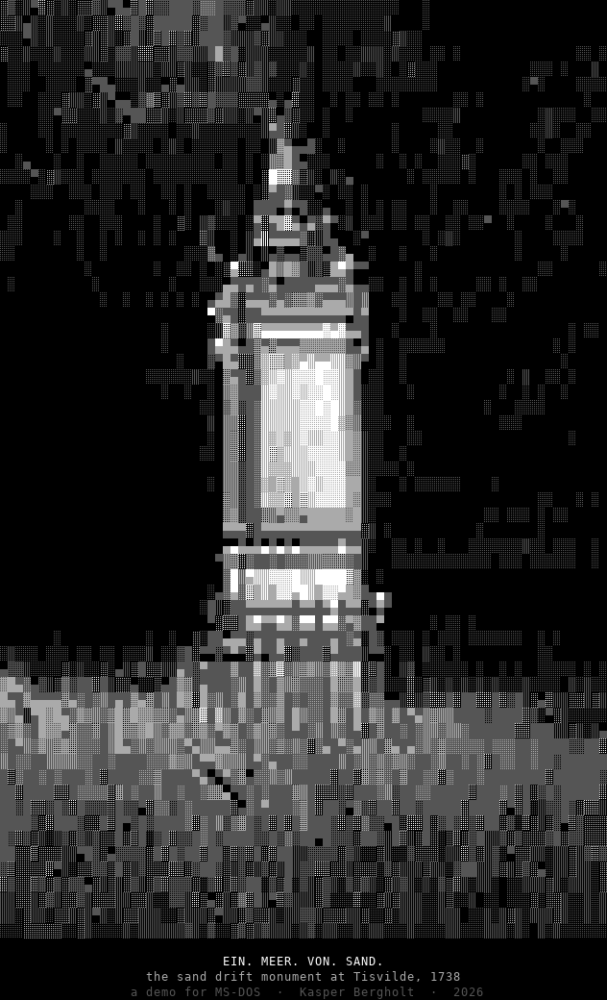

# EIN. MEER. VON. SAND.

**The Sand Drift Monument, Tisvilde — a work for MS-DOS**  
Kasper Bergholt · 2026 · approximately 8 minutes 54 seconds

A monument records the stopping of sand. The program puts its letters back into motion.

The Danish and German inscriptions of the Sand Drift Monument at Tisvilde, erected in 1738, are read alongside English translations. Each letter selects a harmonic of A2 (110 Hz). The modulus moves from twelve to seventeen; the same letter can return at a different pitch. Characters leave the text and accumulate in a sea below it, while their earlier tunings remain in the drone.

[Work and historical context](https://bergholt.net/sand) · [Extended description](docs/PROJECT-DESCRIPTION.md) · [Sources](docs/SOURCES.md)

## The ANSI work



Browser preview rendered from the supplied `SAND.ANS`. The preview uses an approximate terminal typeface; the original ANSI file, including its SAUCE metadata, is preserved. This is the accompanying ANSI image, not a capture of the animated DOS program.

## The rule

For a letter at alphabet position `p` and the current modulus `M`:

```text
k = p mod M
if k = 0: k = M
frequency = 110 × k Hz
```

A–Z occupy positions 1–26; Æ, Ø and Å occupy 27–29. Digits use their numeric values, with a zero remainder handled by the same rule. The modulus changes in discrete score sections, from 12 to 17. Letter recurrence within a line sets a weight with exponent 0.8. Vowels swell and hold; consonants strike.

The columns are German / Danish / English, left to right. The English part contains translations of both surviving inscription languages. Related words share motif triggers. A section marked Latin addresses the missing reading without supplying a reconstructed Latin inscription.

The score and audio were prepared in advance. During playback Pascal renders the graphics and streams `SAND.SND`; the soundtrack is not synthesised live by the DOS executable. Playback time follows the sound card's DMA position.

## Run

Install DOSBox separately. From this repository's root directory:

```sh
dosbox -conf DOSBOX.CONF
```

On Windows, `RUN.BAT` looks for DOSBox on PATH and in several standard installation locations. The supplied configuration mounts the current directory and starts `SAND.EXE`.

Alternatively, inside DOSBox:

```dos
mount c "PATH-TO-SAND-FOLDER"
c:
sand
```

Press **Esc** to quit. `sand 300` begins five minutes into the work when entered at a DOS prompt. Keep `SAND.EXE` and `SAND.SND` together.

The supplied notes specify a 386 or better, VGA 320 × 200 with 64 greys, and Sound Blaster 16. The configuration uses `A220 I7 D1`. Original hardware requirements have not been independently tested for this package.

## Files

| Path | Contents |
| --- | --- |
| `SAND.EXE` | Supplied DOS executable |
| `SAND.SND` | Headerless unsigned 8-bit stereo PCM, 22,050 frames/s |
| `SAND.ANS` | ANSI artwork with SAUCE metadata |
| `SAND.NFO`, `FILE_ID.DIZ` | Original distribution notes and short file description |
| `DOSBOX.CONF`, `RUN.BAT` | Original configuration and Windows launcher |
| `SRC/SAND.PAS` | Main animation and playback program |
| `SRC/VGA.PAS`, `SRC/SND.PAS` | Graphics and Sound Blaster playback units |
| `SRC/FONT8.PAS`, `SRC/ENDSCR.PAS` | Bitmap font and text-mode end screen |
| `SRC/SCOREDAT.PAS` | Prepared score and inscription data |
| `SRC/TEXTS.APL` | Inscription texts, English translations and poem |
| `SRC/SCORE.APL` | Score construction and letter events |
| `SRC/SYNTH.APL` | Sound synthesis functions |
| `docs/BUILD.md` | Build evidence and missing regeneration steps |
| `docs/TECHNICAL-NOTES.md` | Encodings, timing, scope and validation |
| `docs/SOURCES.md` | Historical and artistic references |
| `RIGHTS.md` | Copyright and reuse terms |

All 16 supplied files are preserved byte for byte. Added documentation and the PNG preview are identified separately. `docs/ORIGINAL-FILES.sha256` records their hashes.

## Context

This work follows [Sun](https://bergholt.net/sun), [the system poems](https://bergholt.net/poetry), and [Flora Excursoria Hafniensis](https://bergholt.net/flora). Their shared concern is the relation between a small formal rule and the language it allows us to read or hear. Here that relation unfolds as accumulation: the reading leaves a material trace.

The DOS and ANSI forms also connect to [NetLock BBS](https://bergholt.net/netlock), which Bergholt ran in Hillerød in the 1990s. [Exergue](https://bergholt.net/exergue) records the 2026 return to that history. These are connections of practice and medium, not a claim that Sand was produced in the 1990s or formally released in a demoscene competition.

## Credits and rights

Work, code, original texts and translations, sound and direction: Kasper Bergholt. The supplied `FILE_ID.DIZ` describes the Pascal and APL code as AI-assisted. The soundtrack is described as synthesised in APL from the score.

© 2026 Kasper Bergholt. All rights reserved. The artist confirms ownership and authorises publication of the work and source together. This is a source-available archival package; no additional reuse licence has been selected. See [RIGHTS.md](RIGHTS.md).

## Preservation status

The executable and sound were supplied rather than rebuilt. No DOSBox, Pascal compiler or APL interpreter was available for execution testing during packaging. The archive documents substantial source material, but does not yet provide a verified end-to-end reproducible build. See [build notes](docs/BUILD.md).
